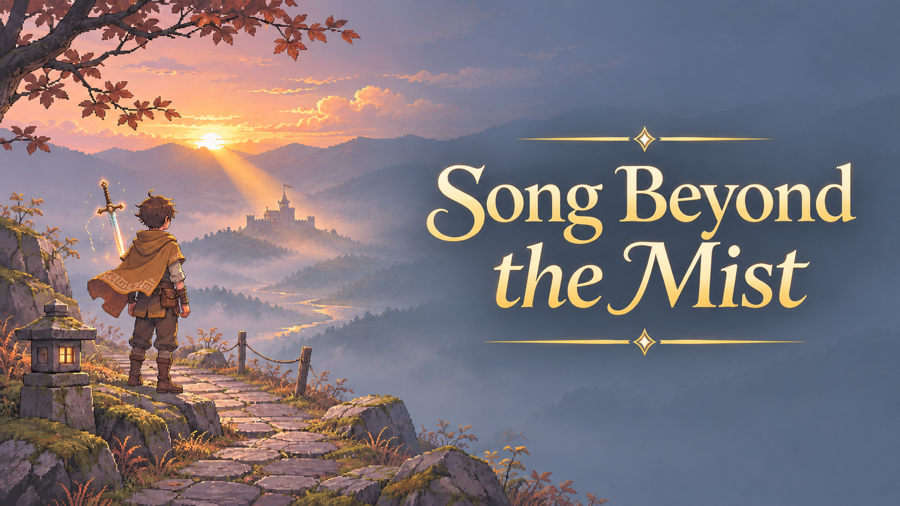

# Song Beyond the Mist

A pixel-art action RPG about a village without water, a missing princess, and a journey into the mist. Chapter One is playable, with Chinese and English options.

[Play in your browser](https://eric-schecter.github.io/song-beyond-the-mist/)

## Controls

- **WASD / arrows:** Move
- **J:** Light attack · **K:** Heavy attack (hold to charge)
- **Q:** Dodge · **Q → J:** Pursuit thrust
- **J → K:** Thrust · **J → J → K:** Spinning slash
- **E:** Interact · **P:** Attributes · **M:** Map · **Tab:** Moves · **Esc:** Pause

Keyboard recommended. Skills consume MP, which regenerates over time.

## Run locally

Open `project.godot` with **Godot 4.7.2**, then run the project. To export Web, run `./tools/export_web.sh`; serve `build/web` over HTTP. The browser needs WebGL 2.

Art includes AI-generated assets; music is generated locally. Font: [SIL OFL](assets/fonts/OFL.txt). Combat audio: [CC0 sources and credits](assets/audio/cc0_combat/LICENSES.md).
